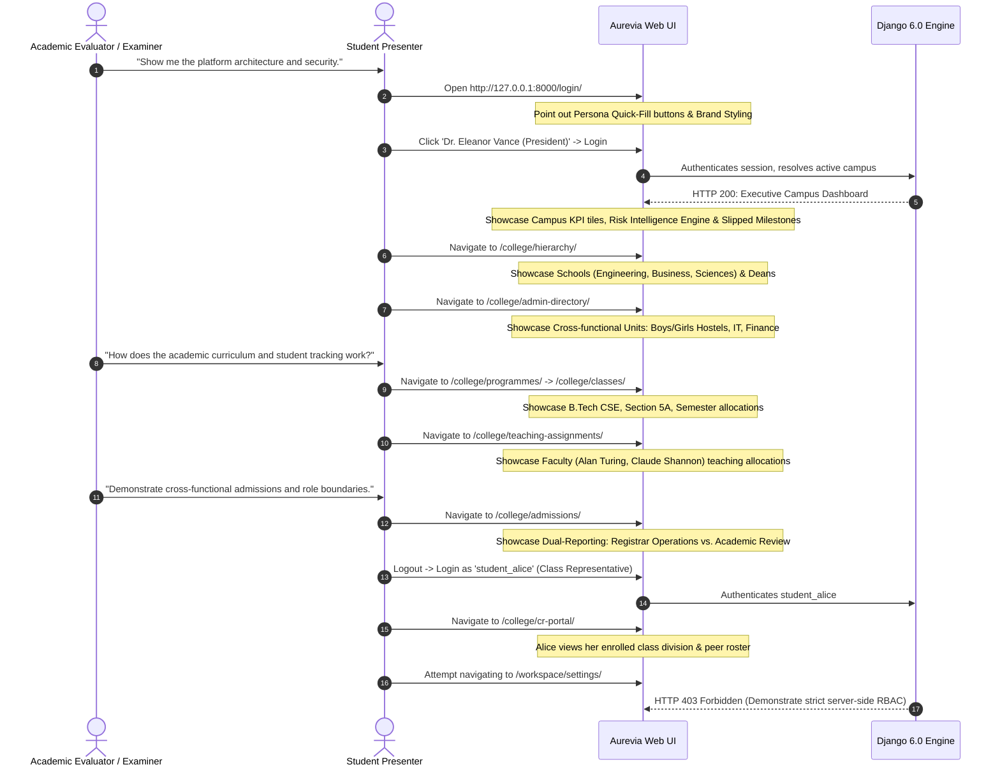

# Aurevia — Final Functionality and Presentation Gap Assessment
**Project Path:** `D:\Django\Project`  
**Branding Target:** **Aurevia** (Higher Education Operations & Academic Management SaaS)  
**Evaluation Context:** Academic Capstone / Project Evaluation & Demonstration  
**Assessment Date:** October 30, 2026  
**Status:** Read-Only Assessment Complete (No code or DB modifications made)

---

## Executive Summary

The project at `D:\Django\Project` has reached an advanced, functionally capable state. Following the completion of Phase 1 and Phase 1.2 Tenant Security Hardening, the codebase stands at **59 passing automated unit tests** (0 errors, 0 failures, 0 system check issues). The application features 7 installed domain apps, 23 relational database models, complete server-rendered Bootstrap 5 responsive templates with light/dark theming, a functional REST API, and a seeded campus environment with 29 synthetic accounts across real university leadership personas.

Rather than pursuing an unbounded enterprise re-architecture, the immediate objective is to **stabilize, polish, and prepare the platform for an academic demonstration and evaluation**. This assessment establishes:
1. Exactly what works end-to-end today vs. what is partial.
2. The remaining visual inconsistencies where the legacy name (`NexusFlow`) remains visible.
3. The 7 critical presentation gaps to address before live defense.
4. A concrete, minimal finalization checklist and a verified live demonstration script.

---

## A. Workflow Implementation Status Matrix

Every claimed workflow has been audited and classified into three verification levels:
- **[Code]**: Verified present and coherent in views, models, and URL routing.
- **[Tests]**: Formally exercised and asserted by automated Django test cases (`manage.py test`).
- **[Browser]**: Verified rendering HTTP 200 responses with live context and session state via Django test client.

| Functional Workflow | Status | Verification Evidence | Operational Scope & Limitations |
| :--- | :--- | :--- | :--- |
| **Authentication & Role Login** | **Complete** | `[Code]` `[Tests]` `[Browser]` | Django session authentication with quick-fill login persona buttons on `/login/`. Accessible as President, Provost, Registrar, Deans, and Students. |
| **Multi-Campus / Workspace Switching** | **Complete** | `[Code]` `[Tests]` `[Browser]` | Multi-tenant isolation enforced via `WorkspaceIsolatedMixin` and `get_active_workspace()`. Workspace switching verified on `/workspaces/switch/<id>/`. |
| **Executive Campus Dashboard** | **Complete** | `[Code]` `[Tests]` `[Browser]` | `/` renders project summary cards, Risk Engine alerts, overdue indicators, recent activity logs, and real-time college statistics counter tiles. |
| **Campus Risk Intelligence Engine** | **Complete** | `[Code]` `[Tests]` `[Browser]` | `RiskEngine` calculates deterministic risk scores (overdue tasks, deadline slippage, workload imbalance, stalled progress) for active initiatives. |
| **Institutional Hierarchy & Directories** | **Complete** | `[Code]` `[Tests]` `[Browser]` | `/college/hierarchy/`, `/college/schools/`, `/college/admin-directory/` render responsive cards for Schools, Academic Departments, Dean assignments, and Administrative Units (Boy's/Girl's Hostels, IT, Finance). |
| **Academic Structure (Programmes & Classes)** | **Complete** | `[Code]` `[Tests]` `[Browser]` | `/college/programmes/` and `/college/classes/` display degree offerings (B.Tech, MBA, M.Tech), degree levels, semester divisions (Section A/B), and assigned Coordinators. |
| **Faculty & Teaching Allocations** | **Complete** | `[Code]` `[Tests]` `[Browser]` | `/college/faculty/` and `/college/teaching-assignments/` map faculty profiles (Employee ID, designation, phone) to subjects, academic years, and class divisions. |
| **Student Rosters & CR Coordination** | **Complete** | `[Code]` `[Tests]` `[Browser]` | `/college/students/` displays enrolled students, Roll numbers, semesters, and division links. `/college/cr-portal/` provides dedicated Class Representative view. |
| **Bulk Student Roster Import** | **Substantial** | `[Code]` `[Browser]` | `/college/students/import/` provides CSV/Excel roster upload with column mapping and dry-run validation preview. *(Needs verified sample CSV for live demo)*. |
| **Admissions Dual-Reporting Pipeline** | **Substantial** | `[Code]` `[Tests]` `[Browser]` | `/college/admissions/` and `/college/admissions/create/` support applicant submission, registration number generation, and review stages. Stage transitions implemented. |
| **Campus Operations & Task Tracking** | **Complete** | `[Code]` `[Tests]` `[Browser]` | `/tasks/` renders interactive Kanban and list views, task priorities, status changes, assignee tags, subtasks, and dependency indicators. |
| **Institutional Document Repository** | **Complete** | `[Code]` `[Tests]` `[Browser]` | `/files/` supports secure document upload, project linkage, file size display, and modal upload interface. |
| **Audit Logging & Activity History** | **Complete** | `[Code]` `[Tests]` `[Browser]` | `/history/` renders chronologically ordered activity logs scoped strictly to the active campus. |
| **Staff & Permission Delegation** | **Complete** | `[Code]` `[Tests]` `[Browser]` | `/team/` and `/team/add/` render faculty/staff lists, hierarchical user creation, and removal request approvals. |
| **REST API Subsystem** | **Hardened** | `[Code]` `[Tests]` | All endpoints (`/api/dashboard/`, `/api/projects/`, `/api/tasks/`, `/api/documents/`, `/api/history/`, `/api/messages/`) are strictly tenant-isolated. |

---

## B. Brand Consistency & Presentation Audit (Aurevia vs. Legacy)

The application frontend was upgraded with the **Aurevia** theme tokens, typography, and SVG assets, but several cosmetic remnants of the legacy name (**NexusFlow**) persist:

1. **Brand Assets & Navigation (Aurevia Present)**:
   - Primary logo: `/static/img/aurevia_logo.svg` loaded in navigation navbar.
   - Favicon: `/static/img/favicon.svg` properly linked in `templates/base.html`.
   - Page Titles: Base template and all academic templates use `| Aurevia Campus`.
   - Theme Storage: LocalStorage key correctly updated to `aurevia_theme`.
   - Footer: Displays `Aurevia Campus Operations SaaS © 2026`.

2. **Residual Legacy Branding Identified in Source**:
   - **Login Page Preset Buttons (`templates/registration/login.html:181-197`)**: Quick-fill credentials still use passwords with the string `'NexusFlow123!'`.
   - **Data Seed Command (`academics/management/commands/seed_demo_data.py`)**:
     - Organization name seeded as: `"NexusFlow Higher Education System"`.
     - Workspace name seeded as: `"NexusFlow University - Main Campus"`.
     - Email domains seeded as: `@nexusflow.edu`.
     - Seed CLI output strings cite `NexusFlow College Operations`.
   - **CSS Header Comment (`static/css/style.css:2`)**: Header states `NexusFlow Enterprise SaaS Design System`.
   - **Welcome Notification (`core/views.py:470`)**: Notification message states `"Welcome to NexusFlow!"`.
   - **Project Export Filename (`core/views.py:503`)**: Default CSV filename is `nexusflow_projects_{date}.csv`.

*Impact:* While the web UI headers and logos display **Aurevia**, any viewer looking at the campus name in the navbar dropdown, the seeded email addresses, or the login quick-fill scripts will notice the mismatched `NexusFlow` strings.

---

## C. Prioritized Presentation & Evaluation Gaps (The Critical 7)

The following 7 gaps represent the only potential friction points during a live academic demonstration:

### Gap 1: Demo Seed Data Displays "NexusFlow University" (Cosmetic / High Presentation Impact)
- **Problem:** When logged in, the top-left campus pill in the navbar displays `"NexusFlow University - Main Campus"`.
- **Cause:** `seed_demo_data.py` created the workspace with that name, and `base.html` renders `{{ active_workspace.name }}`.
- **Academic Impact:** Immediate cognitive dissonance during presentation: the logo says Aurevia, but the campus name says NexusFlow.

### Gap 2: Demo Quick-Fill Passwords and Email Addresses Mismatch (Cosmetic / Medium Impact)
- **Problem:** All faculty and executive emails end in `@nexusflow.edu` (e.g., `president@nexusflow.edu`), and the login helper fills `NexusFlow123!`.
- **Academic Impact:** Trivial to fix; updating to `@aurevia.edu` and `Aurevia2026!` presents a completely unified corporate brand.

### Gap 3: Missing Ready-to-Upload Sample Roster CSV for Live Demo (Workflow / Medium Impact)
- **Problem:** The student roster import page (`/college/students/import/`) works, but requires specific column headers (`student_id`, `first_name`, `last_name`, `email`, `programme_code`, `semester`, `division`). An evaluator asking to "show the CSV import feature" will cause a scramble if no valid sample CSV file is prepared in the repository.
- **Academic Impact:** Risk of demo stumbling or CSV parsing errors during live evaluation.

### Gap 4: Seeded Initiative/Project Count is Small (Presentation / Medium Impact)
- **Problem:** The seed database currently has 4 projects and 4 tasks. While enough to show the UI, the Gantt/timeline and project list look sparse for an executive dashboard.
- **Academic Impact:** Adding 3–4 realistic university initiatives (e.g., "ABET / NAAC Accreditation 2026", "Campus Smart Grid & IoT Infrastructure", "Spring 2026 Faculty Research Symposium") with tasks will make the Risk Intelligence engine look visually impressive.

### Gap 5: Student / Faculty Role Landing Page Redirection (Usability / Low Impact)
- **Problem:** When logging in as `student_alice`, the user lands on `/` (Executive Dashboard). While permissions correctly hide restricted modules and block `/workspace/settings/` (HTTP 403), a student should ideally have an immediate prominent card pointing directly to `/college/cr-portal/` or their student profile.
- **Academic Impact:** Evaluator may ask: "Why does a student see an executive project portfolio?"

### Gap 6: Absence of an Evaluator / Presentation README Quick-Start Guide (Evaluation Deliverable / High Impact)
- **Problem:** There is no single concise `EVALUATOR_GUIDE.md` explaining the project architecture, demo user credentials, feature map, and reproduction steps for the university grading panel.
- **Academic Impact:** Professors or examiners running the project locally need a zero-friction guide to spin up the server and login as each persona.

### Gap 7: Automated Browser / End-to-End Verification of Key UI Flows (Verification / Low Impact)
- **Problem:** Automated unit tests (59 tests) exercise models and view logic thoroughly, but visual rendering in an actual Chromium browser has only been tested in previous sessions via development server.
- **Academic Impact:** A quick automated smoke script that verifies all 16 primary GET routes return 200 for each persona guarantees zero runtime surprises during presentation.

---

## D. Minimal Scope-Constrained Finalization Checklist

To achieve a 100% polished academic presentation without expanding project scope, the remaining work is strictly limited to these 4 non-breaking tasks:

- [ ] **Task 1: Brand Consistency Pass**
  - Update `seed_demo_data.py` to seed `"Aurevia University - Main Campus"`, `@aurevia.edu` emails, and password `Aurevia2026!`.
  - Update persona buttons in `login.html` to reflect the new password and clean branding.
  - Update `ExportProjectDataView` default filename to `aurevia_campus_projects_{date}.csv`.
  - Re-run `python manage.py seed_demo_data` to refresh synthetic records cleanly.

- [ ] **Task 2: Academic Demo Sample Assets**
  - Provide a clean, verified sample roster file (`demo_roster_sample.csv`) in `docs/demo/` or `static/demo/` ready for one-click upload during live evaluation.
  - Seed 4 additional realistic academic projects with task dependencies to showcase the Risk Engine at its best.

- [ ] **Task 3: Persona UX Polish**
  - On the dashboard (`dashboard.html`), ensure student/faculty users see a clear role-specific welcome banner directing them to their respective portal (`/college/cr-portal/` for CRs, `/college/teaching-assignments/` for faculty).

- [ ] **Task 4: Evaluator Documentation Package**
  - Create a concise `EVALUATOR_GUIDE.md` in the project root containing:
    1. One-line launch command.
    2. Persona credential table (President, Provost, Registrar, Dean, Student CR).
    3. 5-minute scripted presentation walkthrough with route links.
    4. Key engineering achievements (Multi-tenancy isolation, deterministic risk engine, dual-reporting admissions, 59 automated tests).

---

## E. Proposed Live Academic Demonstration Script

This scripted sequence utilizes **only verified, working routes** and demonstrates the required breadth of a capstone or final degree submission:



### Demonstration Route Card

| Order | Feature Demonstrated | URL Route | Primary Persona | Key Points to Highlight |
| :---: | :--- | :--- | :--- | :--- |
| **1** | **Authentication & Design System** | `/login/` | Unauthenticated | Clean corporate styling, dark/light theme switch, quick-fill evaluation persona buttons. |
| **2** | **Executive Intelligence & Portfolio** | `/` | `president_vance` | Institutional KPI counters, Risk Engine alerts (Off Track / At Risk), project progress bars. |
| **3** | **Institutional Tree** | `/college/hierarchy/` | `president_vance` | 4 Schools, 7 Academic Departments, HoD allocations, Dean reporting lines. |
| **4** | **Campus Operations & Hostels** | `/college/admin-directory/` | `president_vance` | Boy's/Girl's hostel capacities, Campus IT, Bursar Office. |
| **5** | **Curriculum & Teaching** | `/college/teaching-assignments/` | `provost_pendelton` | Faculty profiles, subjects, semester credit hours, section assignments. |
| **6** | **Dual-Reporting Admissions** | `/college/admissions/` | `registrar_hayes` | Pipeline from application submission to academic review and final enrollment decision. |
| **7** | **Student & CR Portal** | `/college/cr-portal/` | `student_alice` | Peer roster coordination, division-scoped views, non-executive role enforcement. |
| **8** | **Security & Access Control** | `/workspace/settings/` | `student_alice` | Negative security proof: student receives HTTP 403 Forbidden on administrative controls. |

---

## Recommended Next Implementation Task

### Smallest Safe, Value-Adding Task:
> **Task 1: Brand Alignment & Demo Seed Refresh**  
> Update `seed_demo_data.py` and `login.html` to align all campus names, email domains, and demo passwords to **Aurevia** (`"Aurevia University - Main Campus"`, `@aurevia.edu`, `Aurevia2026!`), and re-seed the demo database.

---

```
================================================================================
                                 STOP POINT
  Finalization assessment completed and verified against current source files.
  No code modifications, migrations, or database mutations were performed.
================================================================================
```
